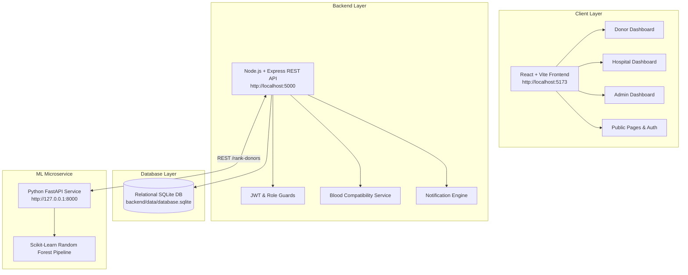

# Smart Blood Donor System 🩸🏥

A full-stack, enterprise-grade healthcare web application connecting voluntary blood donors with certified hospitals in need of lifesaving transfusions. The system combines strict red blood cell ABO/RhD compatibility rules with a demonstrable Machine Learning prioritization engine, synchronized multi-role dashboards (Donor, Hospital, Administrator), real-time notifications, and end-to-end donation lifecycle tracking.

---

## 🌟 Key Highlights

1. **Role-Based Workflows**:
   - **Donor**: Personalized profile, availability toggle, compatible emergency blood alerts, 1-click expression of interest, appointment tracking, and life impact metrics.
   - **Hospital**: Hospital profile with accreditation checks, blood request creation (urgency levels: Normal, High, Critical), Machine Learning donor matching, response coordination, and 1-click donation confirmation.
   - **Administrator**: Hospital accreditation verification (approval/rejection), donor moderation (account activation/deactivation), live audit log trail, and blood group distribution analytics.
2. **Clinical Compatibility Service**:
   - Embedded red blood cell compatibility matrix for all 8 blood groups (O-, O+, A-, A+, B-, B+, AB-, AB+).
   - Incompatible candidates are strictly filtered out before any secondary ranking occurs.
3. **Machine Learning Prioritization Engine**:
   - Python FastAPI microservice trained with Scikit-Learn Random Forest Regressor ($R^2 = 0.986$).
   - Evaluates proximity, medical recovery interval (56-day whole blood rule), availability, and historical engagement.
   - Provides plain-language clinical and logistical contributing factors for transparency.
   - Graceful fallback: If the ML microservice is offline, the backend automatically falls back to an equivalent deterministic scoring heuristic without interrupting user operations.
4. **Relational Database Design**:
   - Relational database using native Node.js high-performance SQLite engine with strict foreign keys (`ON DELETE CASCADE`), unique constraints, WAL mode, and indexes. Zero external database configuration required.

---

## 📐 Architecture Overview



---

## 🗄️ Database Models & Relationships

| Entity | Primary Key | Key Fields & Constraints | Relationships |
|---|---|---|---|
| **User** | `id` (UUID) | `email` (UNIQUE), `password_hash`, `role` (DONOR, HOSPITAL, ADMIN), `is_active` | 1:1 with DonorProfile or HospitalProfile; 1:N with Notifications, AuditLogs |
| **DonorProfile** | `id` (UUID) | `user_id` (FK -> User.id UNIQUE), `blood_group`, `phone`, `city`, `is_available`, `last_donation_date` | 1:N with DonorResponses, Donations |
| **HospitalProfile** | `id` (UUID) | `user_id` (FK -> User.id UNIQUE), `reg_number`, `contact_phone`, `verification_status` (PENDING, APPROVED, REJECTED) | 1:N with BloodRequests, Donations, HospitalVerifications |
| **BloodRequest** | `id` (UUID) | `hospital_id` (FK), `patient_name_or_id`, `blood_group`, `units_required`, `units_fulfilled`, `urgency` (NORMAL, HIGH, CRITICAL), `status` | 1:N with DonorResponses, Donations |
| **DonorResponse** | `id` (UUID) | `request_id` (FK), `donor_id` (FK), `status` (INTERESTED, CONTACTED, ACCEPTED, SCHEDULED, COMPLETED, DECLINED), UNIQUE(`request_id`, `donor_id`) | Prevents duplicate interest expressions; 1:1 with Donation |
| **Donation** | `id` (UUID) | `request_id` (FK), `donor_id` (FK), `hospital_id` (FK), `donor_response_id` (FK UNIQUE), `units_donated`, `status` | Official verified collection certificate |
| **Notification** | `id` (UUID) | `user_id` (FK), `title`, `message`, `type`, `is_read`, `created_at` | Tracks user-specific updates |
| **HospitalVerification** | `id` (UUID) | `hospital_id` (FK), `reviewed_by_admin_id` (FK), `status`, `review_notes` | Accreditation log |
| **AuditLog** | `id` (UUID) | `user_id` (FK), `action`, `entity_type`, `entity_id`, `details`, `ip_address` | Immutable security audit trail |

---

## 🔬 Red Blood Cell Transfusion Compatibility Rules

The backend strictly enforces standard red blood cell transfusion rules:

- **Recipient O-**: Accepts only **O-** (Universal Donor blood).
- **Recipient O+**: Accepts **O-**, **O+**.
- **Recipient A-**: Accepts **O-**, **A-**.
- **Recipient A+**: Accepts **O-**, **O+**, **A-**, **A+**.
- **Recipient B-**: Accepts **O-**, **B-**.
- **Recipient B+**: Accepts **O-**, **O+**, **B-**, **B+**.
- **Recipient AB-**: Accepts **O-**, **A-**, **B-**, **AB-**.
- **Recipient AB+**: Accepts all 8 blood groups (Universal Recipient).

> *Disclaimer: Digital compatibility matching functions as preliminary screening and logistical prioritization. Clinical eligibility crossmatching is mandatory by qualified healthcare personnel prior to transfusion.*

---

## 🤖 Machine Learning Service (FastAPI + Scikit-Learn)

### Dataset & Features
The model is trained on a documented clinical and logistical dataset (`ml_service/data/donor_dataset.csv`):
1. `is_available` (78.8% feature importance): Donor operational status.
2. `distance_km` (10.4% feature importance): Proximity in km from hospital.
3. `days_since_last_donation` (8.3% feature importance): Rest interval ($\ge 56$ days recommended for whole blood).
4. `historical_response_rate` (1.7% feature importance): Donor engagement reliability.
5. `request_urgency_score` (0.7% feature importance): Normal (1), High (2), Critical (3).
6. `compatibility_level` (0.1% feature importance): Exact match (1.0) vs. compatible alternate (0.85).

### Evaluation Metrics
- **$R^2$ Score**: `0.9863`
- **Mean Absolute Error (MAE)**: `2.33`
- **Root Mean Squared Error (RMSE)**: `2.96`

---

## 🔐 Demo Accounts Ready for Testing

The development database is pre-seeded with realistic healthcare test accounts. For testing, the login screen includes **1-click quick-fill demo buttons**:

### 1. System Administrator
- **Email**: `admin@demo.com`
- **Password**: `AdminPassword123!`
- **Role**: `ADMIN`
- **Capabilities**: Hospital verification approval/rejection, user moderation, system statistics, and audit logs.

### 2. Hospital (Approved)
- **Email**: `cityhospital@demo.com`
- **Password**: `Password123!`
- **Facility**: City General Hospital (Status: `APPROVED`)
- **Capabilities**: Create blood requests, view ML-ranked compatible donors, review responses, schedule appointments, confirm completed collections.

### 3. Hospital (Pending Review)
- **Email**: `valleyclinic@demo.com`
- **Password**: `Password123!`
- **Facility**: Valley Care Trauma Center (Status: `PENDING`)
- **Capabilities**: Registered facility awaiting administrative accreditation.

### 4. Donors
- **Email**: `donor@demo.com` | **Password**: `Password123!` | Rahul Sharma (A+, Koramangala)
- **Email**: `sarah@demo.com` | **Password**: `Password123!` | Sarah Jenkins (O- Universal Donor, Indiranagar)
- **Email**: `david@demo.com` | **Password**: `Password123!` | David Kim (B+, MG Road)

---

## 🚀 Quickstart Guide

### Prerequisites
- **Node.js**: v18.0.0 or higher (v24 recommended)
- **Python**: v3.10 or higher with `pip`

---

### Step 1: Start the ML Service (Port 8000)

```bash
cd ml_service

# Install dependencies
pip install -r requirements.txt

# Train model (already pre-trained and serialized to model/donor_ranker.joblib)
python model/train.py

# Start FastAPI server
python -m uvicorn app.main:app --host 0.0.0.0 --port 8000 --reload
```
*Health Check: `http://localhost:8000/health`*  
*Interactive Swagger API Docs: `http://localhost:8000/docs`*

---

### Step 2: Start the Backend API (Port 5000)

```bash
cd backend

# Install dependencies
npm install

# Run seed script (creates relational database and demo data)
npm run seed

# Run automated tests (22/22 unit and API integration tests)
npm test

# Start backend server
npm start
```
*Health Check: `http://localhost:5000/api/health`*

---

### Step 3: Start the Frontend Application (Port 5173)

```bash
cd frontend

# Install dependencies
npm install

# Build production bundle
npm run build

# Start Vite development server
npm run dev
```
*Frontend Application: `http://localhost:5173`*

---

## 🧪 Automated Testing

### Backend Integration Test Suite (Node.js)
```bash
cd backend
npm test
```
**Results**:
- `22 tests passed (0 failures)`
- Validates red blood cell compatibility for all 8 blood groups.
- Tests JWT token generation and authentication.
- Tests Role-Based Access Control (RBAC) preventing normal users from accessing admin routes.
- Tests blood request creation, duplicate interest expression prevention (409 Conflict), and notification dispatches.

### ML Microservice Test Suite (Pytest)
```bash
cd ml_service
pytest
```
**Results**:
- `5 tests passed (0 failures)`
- Validates synthetic dataset generation bounds ($0 - 100$).
- Tests urgency level mapping and contributing factor explanations.
- Tests `/rank-donors` inference endpoint and candidate sorting.

---

## 📋 Major Workflow Demonstration Checklist

- [x] **Hospital Posts Request**: Log in as `cityhospital@demo.com`, click "+ Create Blood Request", specify patient identifier, blood group `A+`, units `2`, urgency `CRITICAL`, and required date.
- [x] **ML Prioritizes Candidates**: Navigate to the request and click "ML Matches". The system displays ranked compatible donors with suitability score, priority category (e.g. HIGH PRIORITY), and top factors.
- [x] **Donor Expresses Interest**: Log in as `donor@demo.com` (Rahul Sharma, A+). The matching request appears on their dashboard. Click "Interested in Donating".
- [x] **Hospital Reviews & Accepts**: Log back in as `cityhospital@demo.com`. Go to "Review Responses". Accept Rahul's interest, which unmasks his contact phone number.
- [x] **Hospital Schedules & Confirms**: Click "Schedule Collection Appointment" to book date/time. Once collected, click "Confirm Blood Collection & Complete Donation".
- [x] **Lifecycle Synchronized**: The request increments fulfilled units. Once fulfilled, request status marks `FULFILLED`. Donor's profile updates donation history and estimated lives saved count.
- [x] **Admin Verification**: Log in as `admin@demo.com`. View the pending verification for Valley Care Trauma Center. Click "Review Verification" and approve the facility. View live audit logs and the blood group distribution doughnut chart.

---

## 🛡️ Security, Privacy & Reliability Features

- **Strict Server-Side Authorization**: Authenticated user identity and permissions are verified on the server from signed JWTs; client-supplied IDs are never trusted.
- **Privacy Masking**: Contact numbers and private addresses of donors remain masked until a mutual expression of interest and hospital acceptance occurs.
- **Rate Limiting**: Brute-force protection applied via rate limiting middleware on authentication and sensitive endpoints.
- **Atomic Transactions**: Database status changes, inventory adjustments, and donation confirmations execute within relational SQL transactions to prevent race conditions.
- **Graceful Fallbacks**: The system seamlessly switches between the FastAPI ML model and deterministic heuristics if microservices experience downtime.
